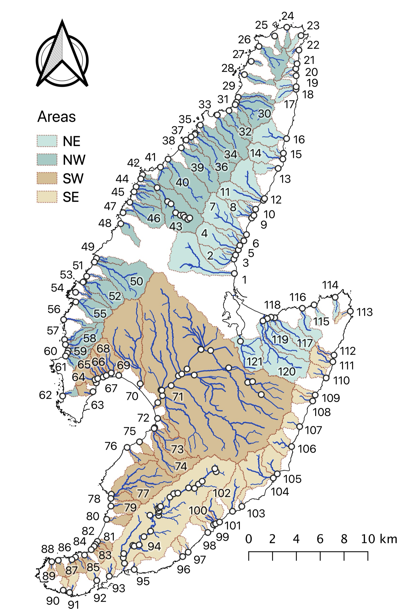

# Sado_eDNA_common

Common sequence data processing for the eDNA metabarcoding study of freshwater fish on Sado Island (MiFish 12S, Illumina MiSeq; samples from 2018, 2019 and 2022)

This repository covers the steps shared by all downstream analyses, from raw reads to phyloseq objects:

- Primer removal (cutadapt), ASV inference (DADA2) and false-positive ASV removal (gmmDenoise) for each sequencing run
- Merging of runs, taxonomic assignment (Claident) and phylogenetic tree construction
- Integration with sample metadata and removal of non-target ASVs (`08_Phyloseq/fw_smpl_ps.rds`)

Downstream analyses are maintained in separate repositories that use the outputs of this repository.

